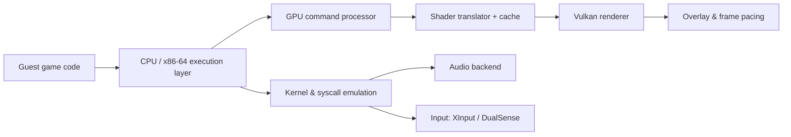

<div align="center">

# GTA6-KytyPS5-GTA-6

### A KytyPS5 fork built around one goal: a comfortable Grand Theft Auto VI experience on PC.


<p>
  
  
  
  
</p>


</div>

---
> [!NOTE]
> This project is **not affiliated with** Sony Interactive Entertainment, Rockstar Games or
> Take-Two Interactive. It contains **no games, firmware, keys or copyrighted files** and does not
> help you obtain them. You must use your own legally dumped copy of the game.


<div align="center">
<a href="../../releases">
  
</a>
</div>


## 💻 System requirements


| | Minimum | Recommended |
|---|---|---|
| **OS** | Windows 10 64-bit (22H2) | Windows 11 64-bit |
| **CPU** | 6 cores, AVX2 | 8+ cores, high single-thread performance |
| **GPU** | Vulkan 1.3 capable, 8 GB VRAM | 12 GB+ VRAM, recent NVIDIA / AMD |
| **RAM** | 16 GB | 32 GB |
| **Storage** | SSD, 300 GB free | NVMe SSD, 300 GB free |
| **Drivers** | Latest GPU driver | Latest GPU driver |

> [!TIP]
> An SSD matters a lot: the game streams large amounts of data, and shader cache files are written
> continuously during the first hours of play.

## Quick start

1. **Download** the latest `KytyPS5-GTA-6-vX.Y.Z-win64.zip` from [Releases](../../releases/latest).
2. **Extract** it to a folder with a short path and no special characters, for example `C:\Emulators\KytyPS5-GTA-6`.
3. **Update your GPU driver** (Vulkan 1.3 is required).
4. **Run** `kyty.exe`.

The first launch is slower because shaders are compiled and cached. Later launches are faster
and noticeably smoother.

## Configuration

Configuration lives in `config/` next to the executable.

```text
KytyPS5-GTA-6/
├── KytyPS5-GTA-6.exe
├── config/
│   ├── global.toml          # default settings
│   └── games/
│       └── gta6.toml        # per-game overrides
├── cache/
│   └── shaders/             # persistent shader cache
├── logs/
└── docs/
```

Example `config/games/gta6.toml` <!-- SAMPLE -->:

```toml
[graphics]
preset            = "balanced"
resolution_scale  = 1.0
upscaler          = "off"        # off | fsr
frame_limit       = 60           # 0 = unlimited
vsync             = false

[shaders]
async_compile     = true
cache_enabled     = true

[audio]
latency_ms        = 80

[input]
profile           = "xinput"     # xinput | dualsense
deadzone          = 0.12

[debug]
overlay           = true
log_level         = "info"       # error | warn | info | debug
```

## 🎮 Controls

| Action | Keyboard | Controller |
|---|---|---|
| Toggle overlay | `F1` | `Back + Y` |
| Screenshot | `F12` | `Back + X` |
| Pause emulation | `F5` | `Back + Start` |
| Toggle fullscreen | `Alt + Enter` | — |
| Reload shader cache | `Ctrl + R` | — |
| Quit | `Alt + F4` | `Back + Start (hold)` |

## Troubleshooting

<details>
<summary><b>The game does not start / crashes immediately</b></summary>

- Make sure your GPU driver is up to date and supports Vulkan 1.3.
- Check that the game folder is complete and uses a supported layout.
- Delete the `cache/` folder and try again.
- Run with `log_level = "debug"` and attach `logs/latest.log` to an issue.

</details>

<details>
<summary><b>Heavy stuttering</b></summary>

- The first hours are the slowest: the shader cache is still being built.
- Enable `async_compile` and make sure the cache is on an SSD.
- Close overlays from other software (recording, RGB, monitoring tools).
- Try the **Performance** preset.

</details>

<details>
<summary><b>Black screen or missing graphics</b></summary>

- Switch the Vulkan device in settings if you have several GPUs.
- Disable third-party Vulkan layers (some overlays inject them).
- Attach a log and your GPU model to an issue.

</details>

<details>
<summary><b>No sound or crackling audio</b></summary>

- Increase `latency_ms` in the audio section (try 120).
- Make sure the default Windows audio device is not in exclusive mode for another app.

</details>

<details>
<summary><b>Controller is not detected</b></summary>

- Reconnect the controller before starting the emulator.
- For DualSense, use USB or a supported Bluetooth connection and select the `dualsense` profile.


<details>
<summary><b>Will other PS5 games work?</b></summary>

Possibly, since the fork builds on the same core, but only GTA 6 is actively tested.

</details>

<details>
<summary><b>Is there a Linux or macOS build?</b></summary>

Windows is the primary target. Linux is experimental, macOS is not supported yet.

</details>


## Architecture

<!-- SAMPLE: replace with your real module layout -->



| Module | Responsibility |
|---|---|
| `core/` | Guest memory, CPU execution, syscalls |
| `gpu/` | GPU command stream, shader translation, shader cache |
| `render/` | Vulkan backend, upscaling, frame pacing |
| `audio/` | Audio output and latency handling |
| `input/` | Keyboard, XInput, DualSense |
| `launcher/` | Library, presets, bug reporter |

## Roadmap

- [x] Fork setup and CI builds
- [x] GTA 6 game profile and presets
- [x] Persistent shader cache
- [x] Performance overlay
- [ ] Stable boot to main menu on all tested GPUs
- [ ] Stable in-game performance on mid-range hardware
- [ ] Remove remaining graphical artefacts
- [ ] Audio sync in cutscenes
- [ ] Controller polish (DualSense features)
- [ ] Linux parity
- [ ] Send generic fixes upstream

See the [issue tracker](../../issues) and [project board](../../projects) for details.

## Contributing

Contributions are welcome.

1. Fork the repository and create a branch: `git checkout -b feature/my-change`
2. Keep generic emulator fixes in **separate commits** from GTA 6 specific changes.
3. Add or update tests where it makes sense.
4. Open a pull request describing **what** changed and **how you tested it**.

Please read [CONTRIBUTING.md](CONTRIBUTING.md) and follow the [Code of Conduct](CODE_OF_CONDUCT.md).
For larger changes, open an issue first.

## Reporting issues

Use the issue templates and include:

- build version or commit hash,
- game version,
- CPU, GPU and driver version,
- OS version,
- your settings (`config/`),
- `logs/latest.log`,
- steps to reproduce, and a screenshot or short video if relevant.

The launcher's **Create bug report** button collects most of this automatically.

> [!IMPORTANT]
> Do not post links to game files, keys or firmware in issues or discussions. Such posts will be deleted.

## Credits

- **[InoriRus](https://github.com/InoriRus/Kyty)** — the original Kyty emulator
- **[KytyPS5 contributors](https://github.com/KytyPS5/KytyPS5)** — the PS5 emulator this fork builds on
- Everyone who tests builds and files detailed reports
- [FFmpeg](https://ffmpeg.org/), [Vulkan](https://www.vulkan.org/), [Qt](https://www.qt.io/) and other open-source projects used by this fork

---

**If this project helps you, consider giving it a ⭐**

</div>

